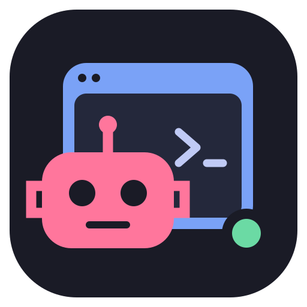
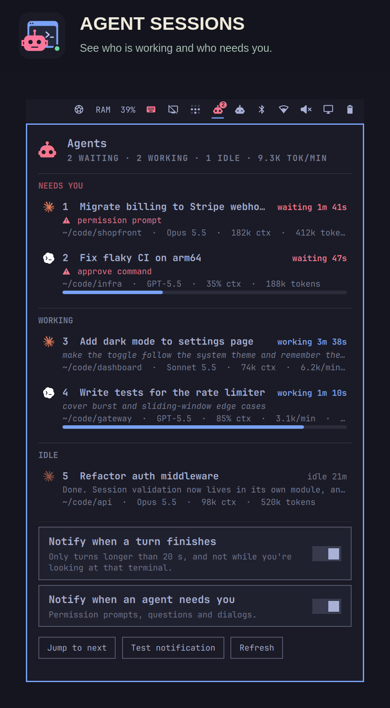

#  Agent Sessions (grivera.agents)

Omarchy bar widget that shows every Claude Code, Codex, OpenCode and Grok session running
on this machine. You can see which ones are working, which ones are waiting on you (a
permission prompt, a question, a dialog), and how fast each is burning tokens. It
sends a desktop notification when a long turn finishes or an agent stops to ask you
something. Clicking the notification, or a row in the panel, focuses that session's
terminal window.



A **Usage** tab shows each tool's plan limits (5-hour and weekly windows, with reset
times), what you've spent today, this week and this month, a 14-day chart and the
models behind it. It also counts Grok Build's spend, from the usage Grok records
for each session.

**How it differs from other agent plugins:** it covers Claude Code, Codex,
OpenCode and Grok Build, with no setup. It doesn't need herdr, tmux or hooks, because it reads the
files the CLIs already keep. On top of working/waiting state, it shows tokens per minute and
context fill, and it focuses the exact terminal window for each session.

**Privacy:** it reads only local files, makes no network requests of its own, and nothing
leaves your machine.

## Install

Use Omarchy's plugin manager:

```
omarchy plugin add https://github.com/grivera82/omarchy-agents.git --enable
```

This clones the plugin into `~/.config/omarchy/plugins/grivera.agents`, checks it,
and adds the widget to your bar. When run interactively, it asks which bar section
to use (default: right). Without `--enable`, you can turn it on later with:

```
omarchy plugin enable grivera.agents --section right
```

To update or uninstall:

```
omarchy plugin update grivera.agents
omarchy plugin disable grivera.agents   # hide it but keep it installed
omarchy plugin remove grivera.agents    # delete it
rm -rf ~/.local/state/grivera-agents    # optional: notification settings
rm -rf ~/.cache/grivera-agents          # optional: usage cache
```

The plugin writes only its settings file, in `~/.local/state/grivera-agents/`, and a
usage cache in `~/.cache/grivera-agents/`. It
never changes anything Claude Code, Codex, OpenCode or Grok owns.

There's nothing to configure. It reads files that the CLIs already write:

| | Live state | Tokens and titles |
|---|---|---|
| Claude Code | `~/.claude/sessions/<pid>.json` (`busy` / `idle` / `waiting` and the reason) | the session transcript in `~/.claude/projects/` |
| Codex | the thread index in `~/.codex/state_*.sqlite`, plus running `codex` processes | the rollout in `~/.codex/sessions/` (turns, approvals, `token_count`) |
| OpenCode | sessions and messages in `~/.local/share/opencode/opencode.db`, plus running `opencode` processes | the same database (per-session token totals) |
| Grok | `~/.grok/active_sessions.json` (open sessions and their pids), plus each session's `events.jsonl` (turn started/ended, permission prompts) | the session folder in `~/.grok/sessions/`: `summary.json` (title, model), `updates.jsonl`, `usage.json` (per-turn tokens and cost) |

`CLAUDE_CONFIG_DIR`, `CODEX_HOME`, `GROK_HOME` and `XDG_DATA_HOME` are honoured. It needs Python 3 (standard
library only) and `hyprctl`. Omarchy already includes both.

> **Caveat:** Claude Code's live state comes from its internal session registry
> (`~/.claude/sessions/*.json`), which isn't a documented format. A Claude Code
> update could change it and break the working/waiting status until the plugin
> catches up. Codex's thread index and rollouts are internal too, and so is
> OpenCode's database. OpenCode support needs OpenCode 2.x; 1.x keeps an older
> schema and its sessions aren't listed. Grok Build's session files are internal
> as well (tested with Grok 1.0.52).

## Bar widget

- The robot icon **breathes** while any agent is working, and a badge shows how
  many are working.
- It turns **red** when an agent is waiting on you, and the badge then counts the
  waiting sessions.
- **Left click**: open the panel.
- **Right click**: jump to the next session that needs you, meaning the one that's
  been waiting longest, or else the one that finished most recently.
- **Middle click**: rescan now.

The panel groups sessions under **Needs you**, **Working** and **Idle**. Each row
shows:

- the title (Claude's AI title or your `/rename`, the Codex thread name, or the
  OpenCode session title)
- how long it's been in that state
- the current prompt (while working), the reason (while waiting), or the last reply
  (while idle)
- the folder, the model, the context size, tokens per minute over the last 5
  minutes, and fresh tokens for the session

Codex reports its context window, so Codex rows also get a context fill bar.

"Fresh" tokens are input plus cache writes plus output. Cache reads are left out
because they would swamp the number without saying much about how hard a session is
working. Subagent transcripts (and OpenCode child sessions) count toward their
parent session.

Keys in the panel: `1`–`9` focus that session, `n` jumps to the next one, `r`
rescans, and `,` opens settings (the gear next to the tabs).

## Usage tab

Switch with the **Sessions / Usage** chips, or `s` and `u` in the panel.
`omarchy-shell grivera.agents usage` opens the panel on it (`sessions` opens the other tab),
and `bin/agents usage` prints the same report in a terminal.

Each tool gets a card with:

- **Plan limits**: the session (5-hour) and weekly windows, how full they are, and
  when they reset. Bars turn red at 90%. These come from the records Omarchy's
  `omarchy-agent-usage-update` collectors keep in `~/.local/state/omarchy/agents/usage/`,
  the same ones the built-in agents widget reads. When they're more than 10 minutes
  old and you open the tab, the plugin runs `omarchy-agent-usage-update --limits-only`
  to refresh them. That command is what talks to Anthropic and OpenAI, not this plugin.
- **Spend** today, over 7 days and over 30 days, tokens, and today's prompt count.
- A **14-day chart** of spend per day. Hover a bar for that day's figures.
- The **models** you used in the last 30 days, priciest first.

For Claude Code and Codex, spend is **API-equivalent**: what the tokens in your local
transcripts would cost at API list prices, including cache reads and writes, fast mode
and long-context surcharges. Claude Pro/Max and ChatGPT plans don't bill per token,
so read it as how much use you're getting from the plan, not a bill. Prices live in
`lib/prices.json` (dated). A model missing from it shows "no price" and adds nothing
to the totals. For OpenCode, spend is the cost OpenCode records for each message, so
free models count as $0, and the chart shows tokens instead.

For Grok Build, spend is the cost Grok records for each turn when xAI reports one
(API-key sign-ins), and the API-equivalent from `lib/prices.json` otherwise, so a
SuperGrok sign-in reads as an estimate. Grok has no plan-limit collector in Omarchy,
so its card shows spend only. Turns that a resumed or forked session copies count once.

Parsed token counts are cached in `~/.cache/grivera-agents/usage.json`, so after the
first scan only new transcript lines are read.

## Notifications

- **Finished**: a turn that ran at least `minTurnSeconds` (default 20) went idle. The
  notification names the agent (Claude Code, Codex, OpenCode or Grok) and says how long the turn
  took. Turn on "Show the reply in notifications" to include the start of the
  agent's last reply.
- **Needs you**: a session started waiting on a permission prompt, question or
  dialog. The notification is withdrawn as soon as the session moves on.

Clicking either one focuses the session's terminal. Turn on "Name the session in
notifications" to also show its title, folder and what it's waiting for. Titles
usually come from your first prompt, so this is off by default too.

Notifications go straight to the notification server over D-Bus, not through
`notify-send`, so nothing the plugin sends appears on its own command line. Replies
are still left out by default: Omarchy's notification server (as of 4.0.4) saves each
notification by passing its text to `bash` as an argument, and other users on the
machine can read process arguments in `/proc`. For the same reason session titles,
folders and wait reasons are left out unless you turn them on.

There's no notification for a session in the window you're focused on. Both kinds
can be switched off under the panel's gear (or `,`), which also has a test
notification. When both are off, the panel says so next to the gear. Settings live in
`~/.local/state/grivera-agents/config.json`.

## CLI

```
bin/agents status [--json]   # one-shot report
bin/agents focus next        # focus the session that needs you
bin/agents focus <id|pid>    # focus a specific session
bin/agents daemon            # what the shell runs: JSON lines in and out
```

`focus next` works without the shell, so it can go on a key. For example, in
`~/.config/hypr/bindings.lua`:

```lua
local agents = os.getenv("HOME") .. "/.config/omarchy/plugins/grivera.agents/bin/agents"
o.bind("SUPER + ALT + A", "Jump to waiting agent", agents .. " focus next")
```

## Status for scripts and voice assistants

`omarchy-shell grivera.agents status` prints a JSON summary: each session's tool, title, project folder, state and what it's waiting for, plus the token burn and, per tool, plan limits and spend (today, 7 and 30 days). It never includes prompts or replies. Voice assistants such as [Jarvis](https://github.com/grivera82/omarchy-jarvis) use it to answer questions. It only reads, and works while the widget is in the bar.

## How a session finds its window

The plugin walks up from the agent's process to the Hyprland client that owns it.
Some terminals (Ghostty, for example) run every window from one process. In that case
it picks the window whose title matches the one Claude Code set. Sessions inside
tmux or over SSH have no window of their own, so they're listed but can't be focused.

Codex sessions running in the IDE extension or the desktop app have no CLI process.
They stay listed for 10 minutes after their last activity.

## OpenCode

OpenCode 2.x runs every session inside one background server
(`opencode serve --service`), and terminal UIs connect to it. So a session is tied to
the `opencode` process open in its folder (or started with `--session <id>`), and
that's the window it focuses. Sessions with no terminal, such as ones driven from the
web UI, stay listed while they work and for 10 minutes after.

OpenCode keeps pending permission prompts and questions in the server's memory, not
on disk, so OpenCode sessions show as working or idle but never as waiting on you.

## Hiding automated sessions

Scripts and tools that run agents headless (`claude -p`, `codex exec`, `opencode run`, `grok -p`) can keep
those short-lived sessions out of the list: put an empty `.agents-ignore` file
in the directory they run from. Sessions whose working directory is that
folder, or anywhere below it, are skipped, and send no notifications.

## License

MIT. The Claude and Codex marks in `assets/` come from Omarchy's `omarchy.agents`
plugin (MIT) and belong to their owners. The OpenCode mark is a simplified
rendering of OpenCode's logo, which belongs to its owners. The Grok mark comes from
[lobehub/lobe-icons](https://github.com/lobehub/lobe-icons) (MIT) and belongs to xAI.
